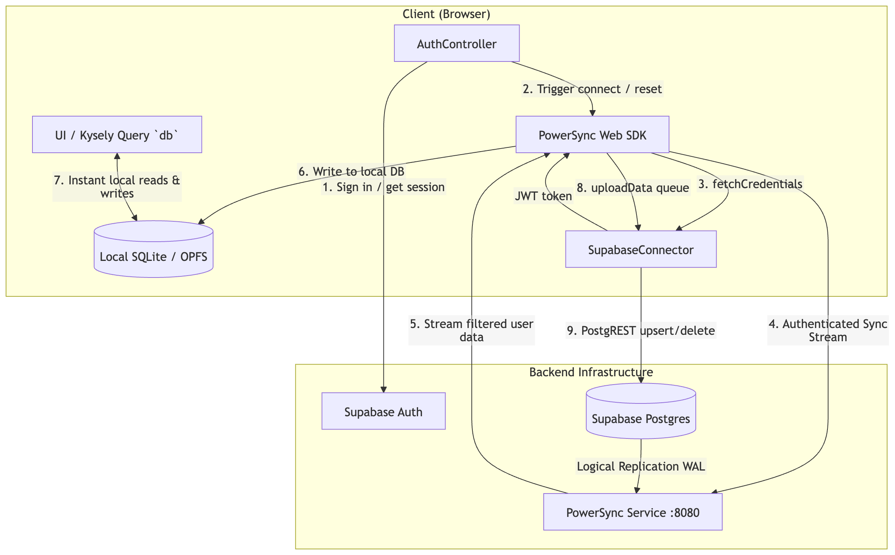

# Supa App

A Deno-managed monorepo for an offline-capable todo app. It combines a Lit/Vite
browser client with a local Supabase backend and a self-hosted PowerSync service.
See [app/README.md](app/README.md) and [backend/README.md](backend/README.md) for
detailed setup instructions.

## How the pieces work together

Supabase is the system of record: it provides authentication and the Postgres
database containing users, lists, and todos. PowerSync reads database changes
through Postgres logical replication and the `powersync` publication, then
streams each signed-in user's authorized rows to a local SQLite database in the
browser. The app reads and writes that local database, so previously synced
data is available offline and local changes can queue until connectivity returns.
The app's Supabase connector uploads queued writes to Postgres, and those changes
are then replicated back to connected clients.

The app signs users in with Supabase Auth and uses the session token to connect
to PowerSync. The PowerSync sync configuration scopes list and todo data to the
authenticated user. On sign-out, the app disconnects and clears synced local
data so it is not left available to another user.



## Repository map

- `app/` — browser app, routing, Supabase Auth, local database and sync client.
- `backend/supabase/` — local Supabase configuration, migrations, and seed data.
- `backend/powersync/` — PowerSync service, Docker setup, and user-scoped sync
  configuration.
- `packages/router/` — shared client-side router workspace package.

## Local development

Install dependencies with Deno, then follow the backend guide to start Supabase
and PowerSync. Configure `app/.env.local` from the provided template and run the
app from its directory:

```sh
deno install
cd app
deno task dev
```

To work on the UI without a running backend, use `deno task dev:offline` from
`app/`. Deno is the recommended package manager; npm/Node tools can be mixed in,
but npm does not support the `workspace:*` dependency specifier used by this
repo. See [app/README.md](app/README.md) for the npm workaround.
